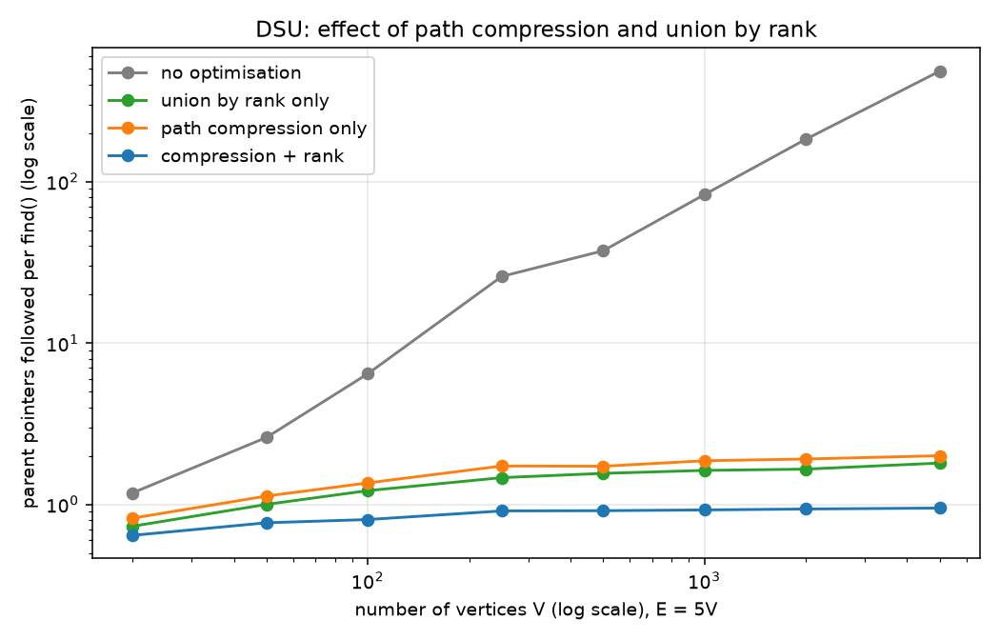
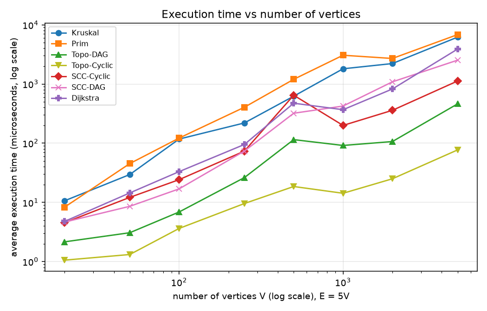
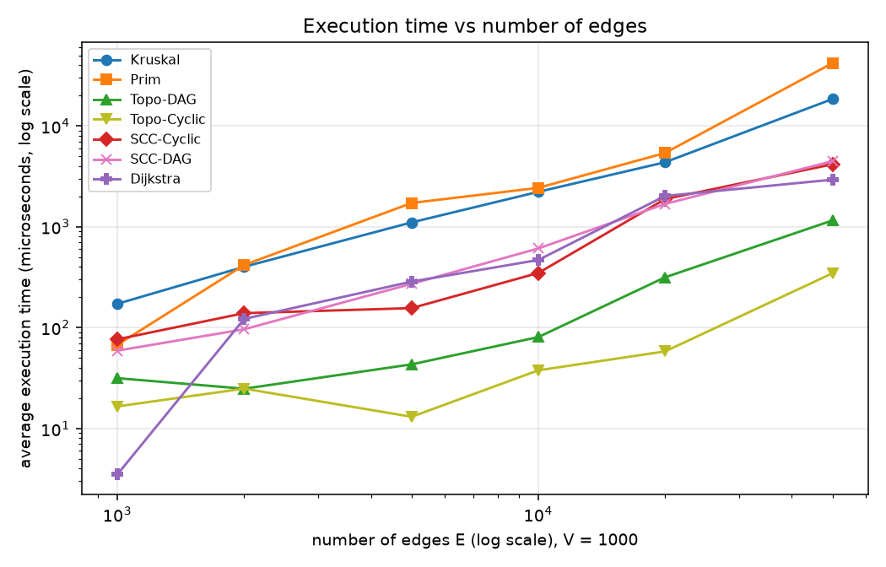
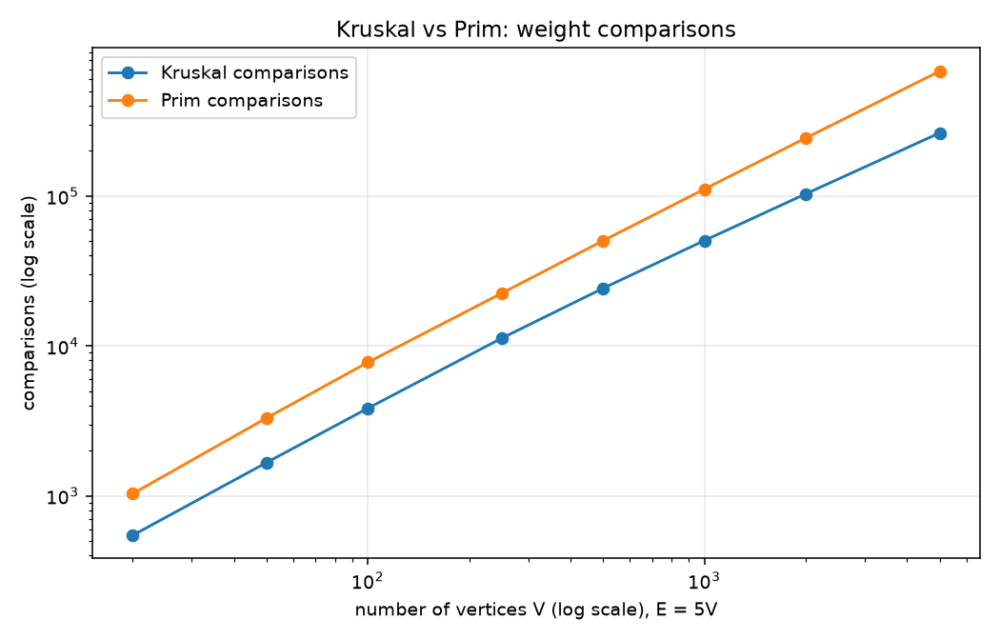

# Assignment 3

## 1. Overview

### 1.1 The system

The project models a city as a graph whose vertices are districts (Downtown, Harbor, Airport, University, TechPark, OldTown, Stadium in the demo) and whose edges are roads, dependencies, or streets. Each algorithm answers one practical planning question:

| Task | Graph type | Algorithm | Question answered |
|---|---|---|---|
| Infrastructure planning | undirected, weighted | **Kruskal** and **Prim** | What is the cheapest set of roads that connects every district? |
| Dependency checking | directed | **Topological ordering** (Kahn) | Can services be built in a valid order, and if not, which ones are blocked by a cycle? |
| One-way street analysis | directed | **Strongly connected components** (Kosaraju) | Which groups of districts can all reach each other? |
| Routing | directed, non-negative weights | **Dijkstra** | What is the shortest route from one district to every other? |

`Main.java` runs each task on a hand-built 7-district example. `Tests.java` verifies correctness (55 checks). `Experiments.java` benchmarks everything and writes `results/tables/results.csv`; `analyze.py` turns that CSV into the tables and plots shown below.

### 1.2 Graph representation

A single class, `graph.Graph`, represents both directed and undirected graphs:

* **Adjacency lists** (`List<List<Edge>>`) give O(deg(v)) neighbour iteration, which is what Prim, Dijkstra, Kahn and the SCC depth-first searches need.
* A separate **edge list** (`List<Edge>`) holds every edge exactly once, which is what Kruskal (sorting), the in-degree computation and the reverse-graph construction need.
* `Edge` is an immutable record `(from, to, weight)`.
* For an **undirected** graph, `addEdge(u, v, w)` stores the edge once in the edge list and **twice** in the adjacency lists (`u -> v` and a mirrored `v -> u`). Consequently an undirected graph with E edges has 2E adjacency entries, which matters when reading the "edge exams" counters for Prim later. A self-loop is stored once.
* A `directed` flag is stored in the graph, and each algorithm rejects the wrong kind (`MST` requires undirected; `Topo`, `SCC` require directed), failing fast with `IllegalArgumentException`.

Space is O(V + E). An adjacency matrix (O(V²)) was rejected because every test graph here is sparse (E = 5V in most experiments) and the matrix would make neighbour iteration O(V) per vertex.

### 1.3 Project layout and how to run

```
src/
  graph/         Graph, Edge, Counters, GraphGenerator
  dsu/           DSU (path compression + union by rank, each switchable)
  mst/           MST (Kruskal, Prim)
  connectivity/  Topo (Kahn), SCC (Kosaraju)
  shortestpath/  Dijkstra
  Main.java      city demo         Tests.java   correctness checks
  Experiments.java  benchmark      analyze.py   tables + plots
results/
  tables/results.csv, tables.md     plots/*.png
```

```bash
# compile library, demo and tests
javac -d out src/graph/*.java src/dsu/*.java src/mst/*.java \
      src/connectivity/*.java src/shortestpath/*.java src/Main.java src/Tests.java
java -cp out Main        # city demo
java -cp out Tests       # 55 correctness checks, exit code 1 on any failure

# benchmark (Experiments.java is a compact source file using java.io.IO: needs JDK 25+)
java -cp out src/Experiments.java results/tables
python3 src/analyze.py results/tables results/plots   # needs matplotlib
```

---

## 2. Implementation

### 2.1 Operation counters

Every algorithm takes a `Counters` object and increments machine-independent counters: `edgeExams` (edges looked at), `comparisons` (weight comparisons, including those done inside `sort` and `PriorityQueue` via instrumented comparators), `dsuFind`, `dsuUnion`, `dsuParentSteps`, `pqOps` (heap insertions plus removals), and `relaxations`. Wall-clock time on a JVM is noisy at the microsecond scale, so these counts are the main tool for comparing measured behaviour with theory.

### 2.2 Disjoint-set union (`DSU`)

* Array-based `parent[]` and `rank[]`.
* `find` is **iterative** (no recursion) and uses two passes: the first finds the root, the second repoints every node on the path directly at the root (path compression).
* `union` links the root of lower rank beneath the root of higher rank (union by rank) and returns `false` if both elements already share a root. That return value is exactly the "would this edge create a cycle?" test Kruskal needs.
* Path compression and union by rank are **independent constructor flags**, so all four combinations can be benchmarked (the ablation in Section 5.2). The default constructor enables both.
* `components()` is maintained as a counter, so Kruskal can report connectivity in O(1).

### 2.3 Kruskal

Copy the edge list, sort it by weight with a counting comparator, then scan: for each edge, `union(from, to)`; if it merged two sets, keep the edge. The scan **stops early** once V − 1 edges are chosen. If the input is disconnected, the result is a minimum spanning *forest* and `connected()` is `false` with the component count reported (tested on a 5-vertex, 2-component graph). The input graph's edge list is never reordered because the sort works on a copy.

### 2.4 Prim

The implementation is the **lazy** variant: a `PriorityQueue<Edge>` holds candidate edges; when a vertex joins the tree, all its edges leading outside the tree are pushed; popped edges whose far endpoint is already in the tree are discarded. A lazy heap was chosen over an indexed decrease-key heap because Java's `PriorityQueue` has no decrease-key and the lazy version is simpler to verify. The outer loop restarts from every unvisited vertex, so Prim also returns a spanning forest on a disconnected graph, matching Kruskal's behaviour and allowing the two to be compared on any input.

### 2.5 Topological ordering (Kahn)

Compute in-degrees in one pass over the edge list, enqueue all zero in-degree vertices, and repeatedly dequeue a vertex, append it to the order, and decrement its successors' in-degrees. **Cycle detection comes for free**: if fewer than V vertices were ordered, a cycle exists. The result then also reports `stuck`, the vertices whose in-degree never reached zero. These are the vertices *on* a cycle **or reachable from one**, not only the cycle itself (the demo shows this: after adding OldTown → Downtown, all seven districts are reported). `isValidOrder` independently re-checks any order against every edge and is used by the tests.

### 2.6 Strongly connected components (Kosaraju)

1. DFS on the original graph, recording vertices in order of finishing time.
2. Build the reverse graph explicitly.
3. Process vertices in decreasing finishing time; each unvisited vertex starts a DFS on the reverse graph, and everything reached is one SCC.

Both DFS passes are **iterative**, using an explicit stack plus a per-vertex `next[]` pointer, so deep graphs cannot overflow the call stack. A test builds a 200,000-vertex path graph to confirm this. Kosaraju was chosen over Tarjan because its correctness argument is easier to state and test, at the price of building the reverse graph.

### 2.7 Dijkstra

Binary heap (`PriorityQueue<long[]>` holding `{distance, vertex}`) with **lazy deletion**: instead of decreasing a key, a better entry is pushed, and stale entries are skipped on removal (`top[0] > dist[v]`). Distances are `long` with `Long.MAX_VALUE` as infinity, so sums cannot overflow for realistic weights and unreachable vertices are unambiguous. A `parent[]` array allows path reconstruction (`pathTo`). Because Dijkstra is incorrect with negative weights, the method **checks all edges first and throws** if any weight is negative. A test shows the failure it prevents: on a small graph with a −4 edge the true distance is 1, but Dijkstra's greedy rule would settle on 2. Zero-weight edges are allowed.

### 2.8 Graph generators

All generators are seeded (`java.util.Random`) so every experiment is reproducible, and none produce self-loops or parallel edges (a `HashSet` of encoded vertex pairs rejects duplicates).

* **`undirectedConnected(n, m, seed, maxW)`**: shuffle the vertices, attach each vertex to a uniformly random *earlier* vertex in the shuffled order (a random spanning tree, which guarantees connectivity), then add random extra edges until m is reached. Requires n − 1 ≤ m ≤ n(n−1)/2.
* **`directedDag(...)`**: assign a random rank to every vertex and orient every random edge from lower to higher rank. The graph is acyclic by construction.
* **`directedRandom(...)`**: uniformly random directed edges.
* **`directedCyclic(...)`**: draws `directedRandom` graphs (advancing the seed) until `Topo` confirms a cycle, so "cyclic" inputs are guaranteed rather than assumed.

Edge weights are drawn uniformly from 1..100 (`MAX_W = 100`).

---

## 3. Complexity Analysis

Notation: V vertices, E edges. Since E ≤ V², log E = O(log V), so O(E log E) and O(E log V) are the same bound. α is the inverse Ackermann function (at most 4 for any realistic input).

| Algorithm | Time (this implementation) | Extra space | Dominant cost |
|---|---|---|---|
| DSU `find`/`union`, compression + rank | O(α(V)) amortised | O(V) | pointer chasing |
| DSU, compression only | O(log V) amortised | O(V) | |
| DSU, rank only | O(log V) worst case per op | O(V) | |
| DSU, neither | O(V) worst case per op | O(V) | long chains |
| **Kruskal** | **O(E log E + E α(V))** = O(E log V) | O(V + E) | sorting the edges |
| **Prim** (lazy, binary heap) | **O(E log E)** = O(E log V) | O(E) heap | heap operations |
| **Topological sort** (Kahn) | **O(V + E)** | O(V) | two passes over edges |
| **SCC** (Kosaraju) | **O(V + E)** | O(V + E) | three passes over edges |
| **Dijkstra** (binary heap, lazy deletion) | **O((V + E) log V)** = O(E log V) when E ≥ V | O(V + E) | heap operations |

**Kruskal.** Sorting E edges costs Θ(E log E) comparisons. The scan performs at most 2E `find` calls (two per `union`). With both DSU optimisations the total DSU cost is O(E α(V)), which is dominated by the sort. Early termination reduces the scan but not the sort, so the worst case stays O(E log E). Without DSU optimisations a `find` can walk a chain of length Θ(V), giving O(EV) in the worst case for the scan; this is the effect the ablation measures.

**Prim (lazy).** Each undirected edge is pushed at most twice (once from each endpoint), so the heap sees at most 2E insertions and 2E removals, each O(log E). Total O(E log E) = O(E log V), and the heap can hold up to O(E) entries. Alternatives for context: an indexed heap with decrease-key gives O(E log V) with O(V) space, a Fibonacci heap gives O(E + V log V), and an array scan gives O(V²), which is best only for very dense graphs. The lazy version trades some memory and extra stale pops for simplicity.

**Kahn.** Computing in-degrees is O(E). Each vertex is enqueued and dequeued once (O(V)), and each edge is relaxed once when its tail is dequeued (O(E)). Total Θ(V + E), exactly 2E edge examinations on a DAG. On a cyclic input fewer vertices are processed, so it can finish earlier, but the in-degree pass is always paid.

**Kosaraju.** Pass 1 (DFS) examines each edge once; building the reverse graph touches each edge once; pass 2 (DFS on the reverse graph) examines each edge once. That is exactly 3E edge examinations plus O(V) bookkeeping, so Θ(V + E) regardless of graph structure. Space is O(V + E) for the reverse adjacency lists.

**Dijkstra.** Each successful relaxation pushes one heap entry, so there are at most E + 1 pushes and E + 1 pops, each O(log E). With the O(E) negativity pre-check and O(V) initialisation the total is O((V + E) log V). With a Fibonacci heap it would be O(E + V log V), but a binary heap is faster in practice at these sizes. The algorithm is *output-sensitive*: it only scans edges out of vertices reachable from the source.

---

## 4. Experimental Setup

### 4.1 Graph sizes

Three families of configurations are run (`Experiments.java`):

| Family | Purpose | Configurations |
|---|---|---|
| `required` | the three mandated sizes | Small V=10, E=30; Medium V=100, E=500; Large V=1000, E=5000 |
| `scaleV` | growth in vertices at fixed density | V ∈ {20, 50, 100, 250, 500, 1000, 2000, 5000}, E = 5V |
| `scaleE` | growth in edges at fixed V | V = 1000, E ∈ {1000, 2000, 5000, 10000, 20000, 50000} |

### 4.2 Generation and inputs per algorithm

Every configuration generates three graphs from the same seed (**seed = 42**) with weights 1..100:

* an **undirected connected** graph, used by Kruskal, Prim and the three DSU variants (and Kruskal and Prim are required to return the same total weight, otherwise the run aborts);
* a **directed acyclic** graph (`Topo-DAG`, `SCC-DAG`);
* a **directed graph with at least one cycle** (`Topo-Cyclic`, `SCC-Cyclic`, and `Dijkstra` from source vertex 0).

Graph generation is excluded from all timings.

### 4.3 Measurement procedure

1. The whole experiment suite is executed **twice**; the first pass is discarded (JVM warm-up, JIT compilation).
2. Each individual measurement calls `System.gc()`, runs the algorithm **20 warm-up times** (discarded), then **5 timed runs** using `System.nanoTime()`.
3. Both the **mean** and the **median** of the 5 runs are recorded, in microseconds. The median is more robust to GC pauses and is shown in brackets in the tables.
4. Operation counters are taken from the last timed run. They are deterministic for a fixed graph, so they do not vary between runs.
5. Output is written to `results/tables/results.csv` (170 rows); `analyze.py` produces `tables.md` and the plots.

### 4.4 Limitations of the setup

* One graph per configuration (a single seed), so there are no confidence intervals across graph instances.
* Five timed runs per point is small; sub-10 µs timings are dominated by timer resolution and JIT effects.
* Absolute times depend on the machine and JVM; the conclusions below therefore rest on ratios, growth rates and operation counts rather than on absolute microseconds.

---

## 5. Results

All times are in microseconds, shown as **average (median)** over the 5 timed runs.

### 5.1 The required graph sizes

#### Table 1 - Kruskal vs Prim (undirected, connected, seed 42)

| Graph | V | E | Algorithm | Avg (median) time, us | Edge exams | Comparisons | DSU find | DSU union | PQ ops | MST weight |
|---|---|---|---|---|---|---|---|---|---|---|
| Small | 10 | 30 | Kruskal | 6.8 (6.9) | 15 | 109 | 30 | 9 | - | 134 |
| Small | 10 | 30 | Prim | 2.6 (2.3) | 60 | 204 | - | - | 60 | 134 |
| Medium | 100 | 500 | Kruskal | 74.1 (72.2) | 180 | 3,839 | 360 | 99 | - | 1153 |
| Medium | 100 | 500 | Prim | 109.0 (108.4) | 1000 | 7,770 | - | - | 1000 | 1153 |
| Large | 1000 | 5000 | Kruskal | 2,837.2 (1,470.1) | 3271 | 50,394 | 6542 | 999 | - | 12900 |
| Large | 1000 | 5000 | Prim | 2,340.0 (2,570.5) | 10000 | 111,028 | - | - | 10000 | 12900 |

#### Table 3 - Topological ordering (Kahn): DAG vs graph with cycles

| Graph | V | E | Input | Avg (median) time, us | Edge exams | In-degree tests | Reported acyclic | Vertices ordered |
|---|---|---|---|---|---|---|---|---|
| Small | 10 | 30 | DAG | 0.6 (0.6) | 60 | 30 | true | 10 / 10 |
| Small | 10 | 30 | Cyclic | 0.6 (0.6) | 30 | 0 | false | 0 / 10 |
| Medium | 100 | 500 | DAG | 14.1 (7.3) | 1000 | 500 | true | 100 / 100 |
| Medium | 100 | 500 | Cyclic | 2.7 (2.6) | 500 | 0 | false | 0 / 100 |
| Large | 1000 | 5000 | DAG | 197.7 (113.9) | 10000 | 5000 | true | 1000 / 1000 |
| Large | 1000 | 5000 | Cyclic | 63.9 (30.8) | 5054 | 54 | false | 10 / 1000 |

#### Table 4 - Strongly connected components (Kosaraju)

| Graph | V | E | Input | Avg (median) time, us | Edge exams | # SCCs | Largest SCC |
|---|---|---|---|---|---|---|---|
| Small | 10 | 30 | Cyclic | 1.8 (1.8) | 90 | 1 | 10 |
| Small | 10 | 30 | DAG | 3.3 (2.7) | 90 | 10 | 1 |
| Medium | 100 | 500 | Cyclic | 27.9 (28.0) | 1500 | 1 | 100 |
| Medium | 100 | 500 | DAG | 25.7 (29.2) | 1500 | 100 | 1 |
| Large | 1000 | 5000 | Cyclic | 949.0 (476.2) | 15000 | 18 | 983 |
| Large | 1000 | 5000 | DAG | 799.7 (619.7) | 15000 | 1000 | 1 |

#### Table 5 - Dijkstra from source district 0 (directed, weights 1..100)

| Graph | V | E | Avg (median) time, us | Edge exams | Relaxations | PQ ops | Comparisons | Reachable | Unreachable |
|---|---|---|---|---|---|---|---|---|---|
| Small | 10 | 30 | 3.0 (2.9) | 30 | 11 | 24 | 63 | 10 | 0 |
| Medium | 100 | 500 | 22.6 (22.3) | 500 | 149 | 300 | 2,050 | 100 | 0 |
| Large | 1000 | 5000 | 744.1 (701.7) | 4946 | 1419 | 2840 | 28,520 | 990 | 10 |

Notes on reading these tables:

* *Edge exams* for Prim is 2E (each undirected edge appears in two adjacency lists). Kruskal's is smaller than E because it stops once the tree is complete.
* In the cyclic graphs of Table 3, a vertex is only ordered if no cycle precedes it. In the Small and Medium graphs *no* vertex could be ordered (0 / 10, 0 / 100), because every vertex lies on or downstream of a cycle; in the Large graph 10 / 1000 were.
* The Large cyclic graph has one giant SCC of 983 vertices plus 17 small ones (Table 4).
* In Table 5, 10 of the 1000 vertices are unreachable from district 0 in the Large graph.

### 5.2 DSU ablation

#### Table 2 - Effect of path compression and union by rank inside Kruskal

| Graph | DSU optimisation | Avg (median) time, us | find() calls | unions | Parent steps | Parent steps per find |
|---|---|---|---|---|---|---|
| Small | none | 8.2 (7.8) | 30 | 9 | 22 | 0.73 |
| Small | compression | 3.1 (3.1) | 30 | 9 | 19 | 0.63 |
| Small | rank | 3.1 (3.1) | 30 | 9 | 20 | 0.67 |
| Small | compression + rank | 6.8 (6.9) | 30 | 9 | 17 | 0.57 |
| Medium | none | 110.3 (110.1) | 360 | 99 | 2321 | 6.45 |
| Medium | compression | 102.4 (101.1) | 360 | 99 | 489 | 1.36 |
| Medium | rank | 66.6 (66.0) | 360 | 99 | 438 | 1.22 |
| Medium | compression + rank | 74.1 (72.2) | 360 | 99 | 290 | 0.81 |
| Large | none | 4,165.9 (3,955.6) | 6542 | 999 | 543294 | 83.05 |
| Large | compression | 2,317.9 (2,359.7) | 6542 | 999 | 12192 | 1.86 |
| Large | rank | 1,550.1 (1,579.7) | 6542 | 999 | 10625 | 1.62 |
| Large | compression + rank | 2,837.2 (1,470.1) | 6542 | 999 | 6045 | 0.92 |



*Parent pointers followed per `find` as V grows (E = 5V). With no optimisation the cost grows roughly linearly in V (1.2, 6.5, 83, 483 at V = 20, 100, 1000, 5000); with either optimisation it stays below about 2; with both it stays below 1.*

### 5.3 Scaling experiments

#### Table 6 - Average time (us) as V grows, E = 5V

| V | Kruskal | Prim | Topo-DAG | Topo-Cyclic | SCC-Cyclic | SCC-DAG | Dijkstra |
|---|---|---|---|---|---|---|---|
| 20 | 10.7 | 8.3 | 2.2 | 1.1 | 4.5 | 4.7 | 4.8 |
| 50 | 29.6 | 45.3 | 3.1 | 1.3 | 12.2 | 8.6 | 14.5 |
| 100 | 117.6 | 122.1 | 6.9 | 3.6 | 24.3 | 17.0 | 33.1 |
| 250 | 219.9 | 404.8 | 26.2 | 9.6 | 73.5 | 73.6 | 95.2 |
| 500 | 622.2 | 1,199.6 | 115.0 | 18.6 | 646.3 | 320.8 | 474.0 |
| 1000 | 1,807.1 | 3,059.9 | 91.7 | 14.3 | 199.8 | 424.3 | 368.0 |
| 2000 | 2,214.6 | 2,699.4 | 106.7 | 25.1 | 359.4 | 1,087.2 | 823.8 |
| 5000 | 6,189.4 | 6,827.9 | 462.0 | 77.1 | 1,124.2 | 2,527.5 | 3,891.8 |

#### Table 7 - Average time (us) as E grows, V = 1000

| E | Kruskal | Prim | Topo-DAG | Topo-Cyclic | SCC-Cyclic | SCC-DAG | Dijkstra |
|---|---|---|---|---|---|---|---|
| 1000 | 172.5 | 67.7 | 31.6 | 16.6 | 76.7 | 59.2 | 3.5 |
| 2000 | 401.3 | 417.8 | 24.8 | 24.9 | 139.2 | 96.4 | 122.1 |
| 5000 | 1,105.1 | 1,722.0 | 43.3 | 13.1 | 156.2 | 272.0 | 286.2 |
| 10000 | 2,220.6 | 2,432.0 | 80.7 | 37.8 | 348.5 | 609.9 | 468.7 |
| 20000 | 4,360.7 | 5,388.3 | 315.6 | 58.2 | 1,880.8 | 1,683.5 | 2,019.2 |
| 50000 | 18,472.0 | 41,935.3 | 1,155.4 | 346.3 | 4,165.4 | 4,468.2 | 2,931.3 |

#### Table 8 - Operation counts as V grows (E = 5V)

| V | E | Kruskal edge exams | Kruskal comparisons | Prim edge exams | Prim comparisons | Prim PQ ops |
|---|---|---|---|---|---|---|
| 20 | 100 | 28 | 546 | 200 | 1,034 | 200 |
| 50 | 250 | 91 | 1,668 | 500 | 3,306 | 500 |
| 100 | 500 | 180 | 3,839 | 1000 | 7,770 | 1000 |
| 250 | 1250 | 635 | 11,258 | 2500 | 22,459 | 2500 |
| 500 | 2500 | 1419 | 24,211 | 5000 | 50,256 | 5000 |
| 1000 | 5000 | 3271 | 50,394 | 10000 | 111,028 | 10000 |
| 2000 | 10000 | 7765 | 103,097 | 20000 | 242,900 | 20000 |
| 5000 | 25000 | 23431 | 262,838 | 50000 | 677,785 | 50000 |







---

## 6. Comparison and Discussion

### 6.1 Kruskal versus Prim

Both algorithms returned identical MST weights on every generated graph, as they must (the experiment aborts otherwise).

* **Operation counts favour Kruskal consistently.** Kruskal performs about 1.9 to 2.7 times fewer weight comparisons than Prim (e.g. 262,838 versus 677,785 at V = 5000; 528,030 versus 1,423,924 at V = 1000, E = 50,000), and examines far fewer edges: on the densest graph it looked at only 3,032 of 50,000 edges (6%) because the tree was complete long before the heavy edges were reached, whereas Prim always pushes through all 2E adjacency entries. On sparse graphs the advantage disappears, since Kruskal must scan most edges (94% at V = 5000, E = 5V; 100% when E = V).
* **Wall-clock time agrees in most cases.** Kruskal had the lower average time in 13 of the 17 configurations, with the gap widening on denser graphs: at V = 1000, E = 50,000 Prim took 41,935 µs against Kruskal's 18,472 µs (2.3×).
* **Prim had the lower average time in the other four configurations:** the smallest inputs (Small, V = 20), the sparsest case (E = V), and Large (by mean only; see the last bullet). On the small and sparse ones, Kruskal's fixed costs (copying and sorting the edge objects, then DSU setup) outweigh its asymptotic advantage. The E = 1000 point (Prim 68 µs versus Kruskal 172 µs, even though Kruskal does *fewer* comparisons there) is **not explained by the operation counts**. It is most plausibly constant-factor and measurement effects (note that Prim's next point, E = 2000, is six times slower for only twice the edges, so the E = 1000 value looks unusually low), and a repeated run with more timed iterations would be needed to say more.
* The Large (V = 1000, E = 5000) row shows why the median is reported: Kruskal's average is 2,837 µs but its median is 1,470 µs, so a few slow runs (most likely GC or JIT) inflated the mean. By median Kruskal is faster than Prim (1,470 versus 2,571 µs).

### 6.2 What Union-Find optimisations buy

The ablation shows the textbook result clearly in the operation counts. At V = 5000 an unoptimised `find` follows 483 parent pointers on average, versus 2.0 (compression only), 1.8 (rank only) and 0.95 (both). That is a 500-fold reduction. The growth of the naive curve (6.5 at V = 100, 83 at V = 1000) is close to linear in V, consistent with its O(V) worst case, while the optimised curves are essentially flat, consistent with O(log V) or O(α(V)).

Wall-clock time follows: at V = 5000 the unoptimised Kruskal takes about 60,000 µs against about 6,200 to 7,700 µs for the three optimised variants (roughly 10×). Among the three optimised variants the *time* differences are within measurement noise at small sizes (e.g. on the Small graph compression + rank, at 6.8 µs, appears slower than compression alone, at 3.1 µs, even though it follows fewer pointers), so the parent-step counts are the trustworthy comparison. Either optimisation alone removes almost all of the damage; using both gives the lowest count, though the extra benefit over one optimisation is small in absolute time because the sort dominates Kruskal's cost anyway.

### 6.3 Topological ordering versus SCC

Both are linear, but with different constants. Kahn's algorithm does exactly 2E edge examinations on a DAG (10,000 for E = 5000) while Kosaraju always does exactly 3E (15,000), and Kosaraju additionally builds a reverse graph out of boxed `Integer` lists. On the Large DAG, SCC took about 4× longer than Kahn (800 µs versus 198 µs). Kahn is also cheaper on cyclic input (64 µs versus 198 µs on the Large graphs, about 3×) because it stops propagating as soon as the cycles block progress; the number of in-degree decrements falls from 5,000 to 54. SCC cost does not depend on structure at all in operation count (always 3E), and the time differences between its cyclic and DAG inputs are noise-level.

The two are complementary rather than competing: Kahn answers "is there a valid order, and which vertices are blocked", at the cheapest cost; SCC answers "which groups are mutually reachable", which is strictly more informative (a graph is a DAG exactly when all SCCs are singletons, as the results confirm: SCC-DAG always reports V components of size 1). The random cyclic graphs also behave like the theory for random digraphs: with average out-degree 5 there is one giant SCC (983 of 1000 vertices, 4,923 of 5000), and at E = V the largest SCC has only 2 vertices (999 components).

### 6.4 Dijkstra

The counters match the analysis exactly: on the Large graph there are 1,419 relaxations and 2,840 heap operations, which is 2 × (1,419 + 1), one push and one pop per successful relaxation plus the source. Only 28% of edges caused a relaxation, so most edge examinations end after a single comparison, and edge exams (4,946) are slightly below E because the 10 unreachable vertices' out-edges are never scanned. The sparse case (V = 1000, E = 1000) took just 3.5 µs because source 0 reaches only 7 vertices: Dijkstra's running time depends on the reachable part of the graph, not on the whole input, which is a property the worst-case formula hides.

### 6.5 Theory versus measurement

To compare growth rates, the table below gives the empirical exponent k in time ∝ size^k, computed from two points of the `scaleV` (V: 100 to 5000, E = 5V) and `scaleE` (E: 2000 to 50,000, V = 1000) series. Because the points were measured with 5 timed runs on one graph each, these are rough estimates.

| Algorithm | Predicted | Exponent, V 100 → 5000 | Exponent, E 2000 → 50,000 |
|---|---|---|---|
| Kruskal | O(E log E) ≈ 1.1 | 1.01 | 1.19 |
| Prim | O(E log E) ≈ 1.1 | 1.03 | 1.43 |
| Topo (DAG) | O(V + E), 1.0 | 1.07 | 1.19 |
| Topo (cyclic) | O(V + E), 1.0 (upper bound) | 0.78 | 0.82 |
| SCC (cyclic) | O(V + E), 1.0 | 0.98 | 1.06 |
| SCC (DAG) | O(V + E), 1.0 | 1.28 | 1.19 |
| Dijkstra | O(E log E) ≈ 1.1 | 1.22 | 0.99 |

(The predicted value of about 1.1 for E log E is the exponent of E·log E between the two endpoints of each series; it is slightly above 1 because of the log factor.)

* **Agreement.** Kruskal's comparison count was between 0.68 and 0.86 of E·log₂E in every configuration checked (V = 100, 1000, 5000 at E = 5V, and E = 5,000 and 50,000 at V = 1000), consistent with the O(E log E) sorting bound. Kahn and Kosaraju edge-examination counts equal 2E and 3E *exactly*, and Dijkstra's heap-operation count equals twice the relaxations plus one. The fitted time exponents are close to 1 for most algorithms, as expected for near-linear and E log E algorithms.
* **Deviations.** Prim's exponent of 1.43 on the E-scaling series and SCC-DAG's 1.28 on the V-scaling series are higher than theory predicts. For SCC the operation count is exactly linear, so the excess most likely comes from memory effects (boxed integers, many small objects, GC) rather than from the algorithm. For Prim, the heap grows with E and holds `Edge` objects scattered in memory, so cache misses plausibly raise the per-operation cost at E = 50,000. The comparison count also grows faster than linearly there, but not enough on its own to explain the whole gap; this explanation is a likely cause, not something these experiments isolate. The cyclic Kahn exponents below 1 are an artefact of early termination: as graphs grow, a larger share of vertices is blocked by cycles, so less work is done.
* **Noise.** Several series are non-monotonic (e.g. SCC-Cyclic at V = 500 is slower than at V = 1000; Topo-DAG at 500 versus 1000). These are JIT and GC artefacts at microsecond scale and are a reason to trust counters over single timings.

---

## 7. Testing

`Tests.java` is a dependency-free test runner (55 checks, exit status 1 on any failure; all pass). The strategy is to combine hand-computed cases, edge cases, and **randomised comparison against an independent oracle**.

| Component | Checks |
|---|---|
| **DSU** | All four (compression × rank) variants: `union` returns `true` for a merge and `false` inside a set, `connected` and `components()` are correct. An optimised DSU follows no more parent pointers than a naive one on a 1000-element chain. |
| **MST** | Hand-solved 4-vertex graph (weight 7); graph with cycles (11); **disconnected graph** detected by both algorithms (2 components, forest weight 8); **ties**: triangle and square with equal weights give the same weight for both algorithms even though several MSTs exist. **300 random small graphs with duplicate weights**: Kruskal = Prim, both equal the **brute-force optimum** (enumerate every (V−1)-edge subset), both results are acyclic spanning trees with V − 1 edges, and all four DSU variants give the same weight. 10 graphs at V = 500, E = 2500: Kruskal = Prim. |
| **Topological sort** | Textbook 6-vertex DAG gives a valid order; 3-cycle, self-loop, and a cycle hidden in a subgraph are all detected (in the last, only vertex 0 is orderable). **200 random DAGs**: all reported acyclic with orders validated against every edge and every vertex appearing once; adding one reversed edge to each makes a cycle that is detected every time. V = 1000 DAG and cyclic cases. |
| **SCC** | Hand-built graph with known components {0,1,2}, {3,4,5}, {6,7}; DAG gives V singletons; ring gives one SCC. **300 random digraphs checked against Floyd–Warshall reachability**: two vertices share a component if and only if each reaches the other, and every vertex is in exactly one component. **200,000-vertex path** confirms the iterative DFS cannot overflow the stack. |
| **Dijkstra** | Known graph (distances and path); unreachable vertex gives `INF` distance and an empty path; zero-weight edges; duplicate weights (two equal shortest paths). **Negative weight rejected** with an exception, plus a test showing the true distance in that example differs from what Dijkstra would report. **300 random directed graphs and 50 undirected graphs: distances equal Bellman–Ford**, and each reconstructed path's edge costs sum to the reported distance. |
| **Single vertex** | All five algorithms on a 1-vertex graph (MST weight 0 and connected; order `[0]`; one SCC; distance 0). |

Additional correctness checks built into the experiment run itself: Kruskal and Prim must produce the same MST weight on every benchmark graph (otherwise the run aborts), and the "cyclic" benchmark graphs are verified cyclic by `Topo` at generation time. `Main.java` provides an end-to-end sanity check on the city example (both MST algorithms report cost 38; the added OldTown → Downtown edge turns the dependency DAG into a cyclic graph; University is correctly reported unreachable from Downtown).

---

## 8. Conclusion

All five algorithms were implemented, tested against independent oracles (brute force, Floyd–Warshall, Bellman–Ford), and benchmarked from 10 to 5,000 vertices and up to 50,000 edges. The main findings:

* **Complexity is confirmed.** Counted operations match the analysis: Kruskal's comparisons follow E log E, Kahn's and Kosaraju's edge examinations are exactly 2E and 3E, and Dijkstra's heap operations equal twice its relaxations. Wall-clock timings show the same growth rates, with deviations attributable to caching, garbage collection and JIT at small scale.
* **Kruskal versus Prim.** They always agree on the MST weight. Kruskal did less work (1.9 to 2.7× fewer comparisons) and was faster in 13 of 17 configurations, especially on dense graphs where early termination skips most edges. Prim is competitive on tiny or very sparse graphs. Choose **Kruskal** when the edges are already in a list or the graph is dense relative to its MST, and when a simple, robust implementation matters; it also handles disconnected input naturally. Prim becomes attractive for dense graphs when implemented with an indexed heap or the O(V²) array version (neither is implemented here), or when the tree must grow outward from a given start vertex. The lazy Prim used here is the weaker variant on dense inputs, as the E = 50,000 results show.
* **Union-Find optimisations matter.** Without path compression and union by rank, find cost grows linearly with V (483 pointer steps per find at V = 5000, about 10× slower Kruskal); with either one it stays below 2, with both below 1.
* **Topological sort versus SCC.** Use **Kahn** to schedule dependencies and detect that a cycle exists: it is the cheapest (2E examinations, and cheaper still when blocked by a cycle) and reports blocked vertices. Use **Kosaraju** when the actual groups of mutually reachable vertices are needed (e.g. one-way street networks): it costs about 4× more here but gives strictly more information, and a graph is a DAG exactly when every SCC is a singleton.
* **Dijkstra** is the right tool for single-source shortest paths with non-negative weights. Its cost is proportional to the *reachable* part of the graph. It must be guarded against negative weights, which this implementation does by rejecting them (Bellman–Ford would be the alternative).

### Limitations and possible extensions

The results use one seeded graph per configuration and 5 timed runs per point, so small timing differences (especially under about 100 µs) should not be over-interpreted. Natural extensions are repeated runs over several seeds with confidence intervals, an indexed-heap Prim, Tarjan's SCC algorithm for comparison, and denser graphs where the O(V²) Prim becomes competitive.
